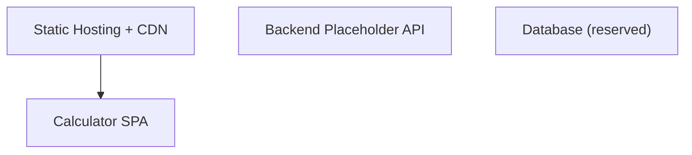
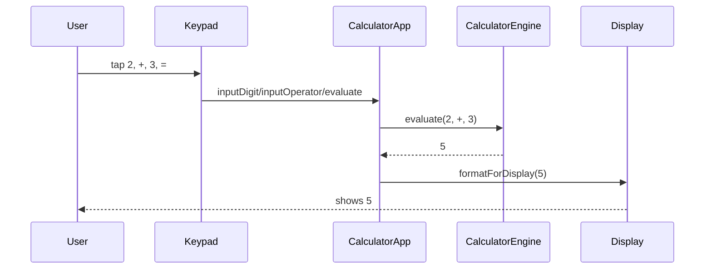
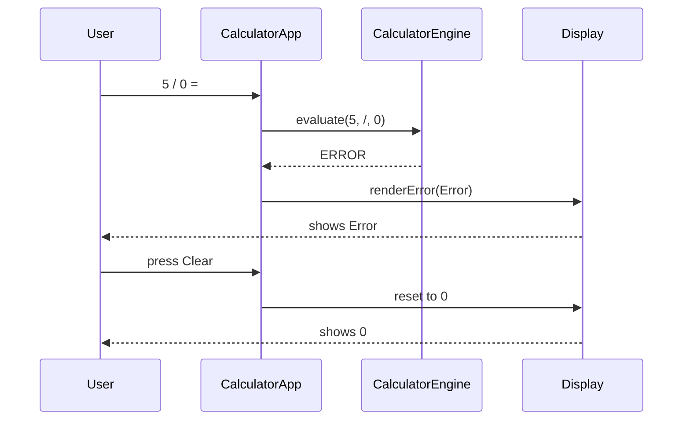
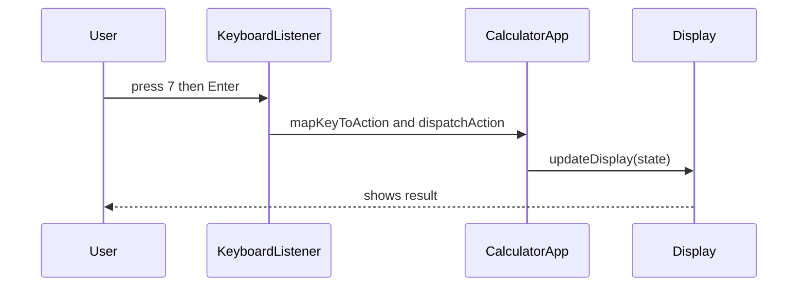
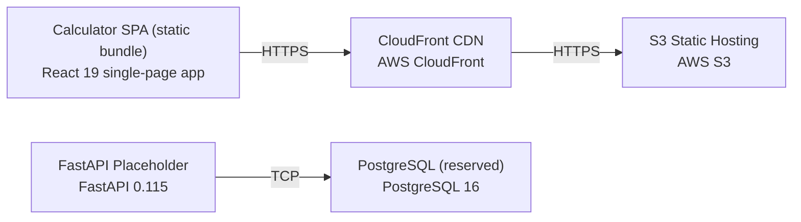

# Architecture

> Maintained by QuorQ AI SDLC. Text between `sdlc:auto` markers is regenerated; anything outside them is yours and is kept.

<!-- sdlc:auto:start narrative -->
## Overview

### ARCH-REV-001 · approved · source: architecture:summary

_2026-10-26_

Architecture version 1 is approved and re-affirms a previously approved design after re-review against unchanged functional requirements (requirements version 5). It is a client-side-only React 19 SPA covering arithmetic, chaining, decimal entry, sign toggle, backspace, clear/reset, digit limiting, keyboard parity, and error handling, served statically from AWS with no login and no persistence.

This revision re-reviewed the prior approved architecture and carried forward unchanged: the four component ids (spa, static_host, backend, db), the three SPA critical paths, the empty data model, the empty API spec, the AWS deployment topology, and all four technology decisions. No new capabilities, services, endpoints, or packages were introduced in this pass.

**Related:** US-001, US-002, US-003, US-004, US-016, US-020, US-005, US-006, US-007, US-019, US-008, US-021, US-022, US-009, US-010, US-011, US-012, US-013, US-014

- ⚠ Data model is empty and API spec is empty by design in this version; no schema or endpoints exist to trace against requirements.
- ⚠ Out-of-scope scientific functions and a memory/history tape remain explicitly undesigned; confirm these are intentionally excluded from current requirement scope.

### ARCH-SPA-001 · approved · source: architecture:components:spa

_2026-10-26_

The Calculator SPA (React 19) is the sole component carrying application logic: it renders the button grid/display, accepts keyboard and on-screen input, and runs the arithmetic engine entirely client-side.

Responsibilities: render responsive button grid and display; handle on-screen and physical keyboard input; hold all calculator state; run the arithmetic engine; manage decimal entry, sign toggle, backspace, clear, and error states — all in-browser with nothing stored or transmitted.

- ⚠ Input does not specify which individual requirement (US-xxx) ids map to specific SPA behaviors; mapping left to requirements/design phase.

### ARCH-STATIC-001 · approved · source: architecture:components:static_host

_2026-10-26_

Static Hosting + CDN (AWS S3 + CloudFront) serves the compiled SPA bundle globally over HTTPS so the app loads once with no further server round-trips.

Serves compiled single-page app bundle globally with low latency over HTTPS; supports fast, login-free, free global access on desktop and mobile per NFR-003.

**Related:** NFR-003

### ARCH-BACKEND-001 · approved · source: architecture:components:backend

_2026-10-26_

Backend Placeholder API (FastAPI 0.115) is provisioned but currently handles no requests; reserved for optional future server endpoints such as usage analytics or shared history.

Not on the critical path for this version. No endpoints, routes, or request handling exist yet. Exists solely to avoid re-platforming if server-side features are added later.

- ⚠ No API spec exists for this component; it is intentionally empty in this version — confirm no current requirement depends on server-side behavior.

### ARCH-DB-001 · approved · source: architecture:components:db

_2026-10-26_

Database (reserved), PostgreSQL 16, is provisioned as the default future persistence store but has no tables, writes, or reads in this version since the calculator stores nothing.

Kept as default persistence store for any future feature requiring memory (e.g., saved calculations, usage counts). No schema defined.

- ⚠ Data model is empty by design; no schema exists to document or trace.

### ARCH-CP-001 · approved · source: architecture:critical_paths:Evaluate an arithmetic operation

_2026-10-26_

Defines the core calculation flow: user enters operand, operator, operand, presses equals, engine computes and displays result, with support for chained operations.

User enters a first operand, an operator, and a second operand, then presses equals; the engine computes the result for add/subtract/multiply/divide/percent, applies the digit limit, and updates the display. Chaining is supported by using the running result as the next first operand.

- ⚠ No explicit requirement ids were given in architecture input for this path; exact US-xxx traceability should be confirmed against requirements phase.

### ARCH-CP-002 · approved · source: architecture:critical_paths:Divide-by-zero and invalid-operation handling

_2026-10-26_

Defines error handling: division by zero or undefined results produce an error marker and error display state, recoverable via clear/reset without reload.

When a division by zero or an otherwise undefined result is evaluated, the engine returns an error marker instead of a numeric value, the display enters an error state, and clear/reset returns the calculator to its initial zero state without reloading.

- ⚠ No explicit requirement ids were given in architecture input for this path; exact US-xxx traceability should be confirmed against requirements phase.

### ARCH-CP-003 · approved · source: architecture:critical_paths:Keyboard and on-screen input parity

_2026-10-26_

Defines input parity: physical keyboard keys (digits, operators, Enter, Backspace, '.', '%') map to the same handlers as on-screen buttons, updating the display identically and immediately.

Physical keyboard key presses (digits, + - * /, Enter for equals, Backspace, . and %) are mapped to the same handlers as the on-screen buttons so both input methods register once and update the display identically and immediately.

**Related:** NFR-002, NFR-004

- ⚠ No explicit requirement ids were given in architecture input for this path; exact US-xxx traceability should be confirmed against requirements phase.

### ARCH-DEPLOY-001 · approved · source: architecture:deployment_nodes

_2026-10-26_

Deployment topology: compiled React SPA runs in-browser, served from S3 object storage fronted by CloudFront CDN; a provisioned FastAPI ASGI service and a managed PostgreSQL instance exist but are unused in this version.

Nodes: Calculator SPA (static bundle, compiled JS/CSS/HTML in browser); S3 Static Hosting (AWS S3, managed object storage); CloudFront CDN (AWS managed global edge network); FastAPI Placeholder (Python ASGI/uvicorn, FastAPI 0.115); PostgreSQL (reserved) (AWS managed PostgreSQL 16). Only the SPA, S3, and CloudFront are active in the critical path; FastAPI and PostgreSQL are provisioned but idle.

### ARCH-TECH-001 · approved · source: architecture:technology_decisions:Frontend

_2026-10-26_

Frontend chosen as React 19 over Vue, Svelte, and Vanilla JS to drive instant display updates and ship as a single-page app with no server round-trips.

React 19 renders the responsive button grid and drives instant display updates for both on-screen taps and keyboard input, and ships as a single-page app that loads once with no server round-trips, matching NFR-002 and NFR-004.

**Related:** NFR-002, NFR-004

### ARCH-TECH-002 · approved · source: architecture:technology_decisions:Backend

_2026-10-26_

Backend chosen as FastAPI 0.115 over Flask, Express, or no backend, purely as a future-ready placeholder since this version has no server-side logic.

There is no server-side logic in this client-only calculator, so FastAPI 0.115 is provisioned only as a lightweight, ready place to add an endpoint later (e.g. usage analytics or shared history) without re-platforming.

### ARCH-TECH-003 · approved · source: architecture:technology_decisions:Database

_2026-10-26_

Database chosen as PostgreSQL 16 over SQLite, DynamoDB, or no database, as a default future store even though nothing persists today.

Nothing is stored or persisted between sessions, so PostgreSQL 16 defines no schema today; it is named as the default dependable store should a future feature (saved calculations, usage counts) need persistence.

### ARCH-TECH-004 · approved · source: architecture:technology_decisions:Cloud

_2026-10-26_

Cloud chosen as AWS over Vercel, Netlify, and Cloudflare Pages to reliably and cheaply serve a free, public SPA worldwide on a single provider.

A free, public SPA must be reliably reachable worldwide; AWS S3 static hosting plus a CloudFront CDN keeps load times low for all desktop and mobile visitors (NFR-003) and keeps every layer on one provider for billing and operations.

**Related:** NFR-003
<!-- sdlc:auto:end narrative -->

<!-- sdlc:auto:start building-blocks -->
## Building Block View

| ID | Name | Technology | Responsibility | Depends on |
|---|---|---|---|---|
| spa | Calculator SPA | React 19 | Renders the responsive button grid and display, handles on-screen and physical keyboard input, holds all calculator state, runs the arithmetic engine, and manages decimal/sign/backspace/clear and error states entirely in the browser. | — |
| static_host | Static Hosting + CDN | AWS (S3 static hosting + CloudFront) | Serves the compiled single-page app bundle globally with low latency over HTTPS so the calculator loads once and runs with no further server round-trips. | spa |
| backend | Backend Placeholder API | FastAPI 0.115 | Provisioned FastAPI service with no current request handling; reserved as a future home for optional server endpoints (e.g. usage analytics or shared history) without re-platforming. Not on the critical path for this version. | — |
| db | Database (reserved) | PostgreSQL 16 | Provisioned PostgreSQL instance kept as the default persistence store for any future feature that must be remembered. No tables, writes or reads in this version since the calculator stores nothing. | — |

<!-- sdlc:auto:end building-blocks -->

<!-- sdlc:auto:start runtime -->
## Runtime View

### Evaluate an arithmetic operation

User enters a first operand, an operator and a second operand, then presses equals; the engine computes the result (add/subtract/multiply/divide/percent), applies the digit limit, and updates the display. Supports chaining by using the running result as the next first operand.

- **Components:** spa
- **Modules:** CalculatorApp, CalculatorEngine, Display, Keypad
- **Key functions:** inputDigit(d), inputOperator(op), inputDecimal(), applyPercent(), toggleSign(), evaluate(firstOperand, operator, secondOperand), formatForDisplay(value, maxDigits)

### Divide-by-zero and invalid-operation handling

When a division by zero or an otherwise undefined result is evaluated, the engine returns an error marker instead of a numeric value, the display enters an error state, and clear/reset returns the calculator to its initial zero state without reloading.

- **Components:** spa
- **Modules:** CalculatorApp, CalculatorEngine, Display
- **Key functions:** evaluate(firstOperand, operator, secondOperand), isError(result), clear(), renderError(message)

### Keyboard and on-screen input parity

Physical keyboard key presses (digits, + - * /, Enter for equals, Backspace, . and %) are mapped to the same handlers as the on-screen buttons so both input methods register once and update the display identically and immediately.

- **Components:** spa
- **Modules:** CalculatorApp, KeyboardListener, Keypad, Display
- **Key functions:** handleKeyDown(event), mapKeyToAction(key), dispatchAction(action), updateDisplay(state)

<!-- sdlc:auto:end runtime -->

<!-- sdlc:auto:start deployment-view -->
## Deployment View

| Name | Service | Runtime | Scaling | Environment |
|---|---|---|---|---|
| Calculator SPA (static bundle) | React 19 single-page app | Browser (compiled static JS/CSS/HTML) | CDN edge distribution; scales with CloudFront | dev |
| S3 Static Hosting | AWS S3 | AWS managed object storage | Managed, effectively unlimited | dev |
| CloudFront CDN | AWS CloudFront | AWS managed global edge network | Global edge caching, auto-scaled | dev |
| FastAPI Placeholder | FastAPI 0.115 | Python ASGI (uvicorn) | Single small instance; idle, no traffic in MVP | dev |
| PostgreSQL (reserved) | PostgreSQL 16 | AWS managed PostgreSQL | Single small instance; unused in MVP | dev |

| Source | Target | Protocol |
|---|---|---|
| Calculator SPA (static bundle) | CloudFront CDN | HTTPS |
| CloudFront CDN | S3 Static Hosting | HTTPS |
| FastAPI Placeholder | PostgreSQL (reserved) | TCP |

<!-- sdlc:auto:end deployment-view -->

<!-- sdlc:auto:start decisions -->
## Architecture Decisions

| Layer | Choice | ADR |
|---|---|---|
| Frontend | React 19 | [ADR-0001](adr/frontend.md) |
| Backend | FastAPI 0.115 | [ADR-0002](adr/backend.md) |
| Database | PostgreSQL 16 | [ADR-0003](adr/database.md) |
| Cloud | AWS | [ADR-0004](adr/cloud.md) |
<!-- sdlc:auto:end decisions -->

<!-- sdlc:auto:start links -->
## Related Documents

- [Data Model](data-model.md)
- [API Specification](api/openapi.yaml)
- [Architecture Decision Records](adr/README.md)
<!-- sdlc:auto:end links -->
