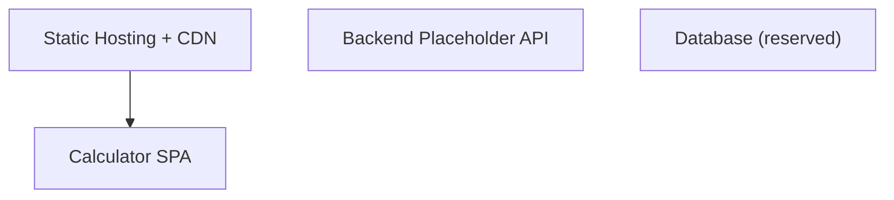
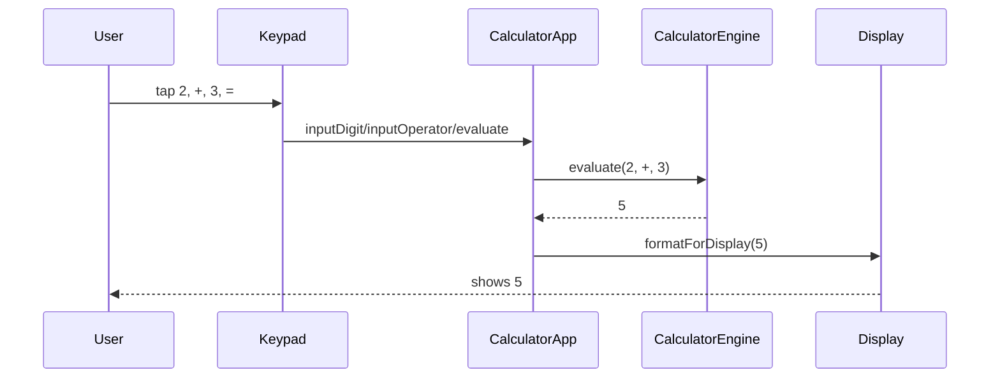
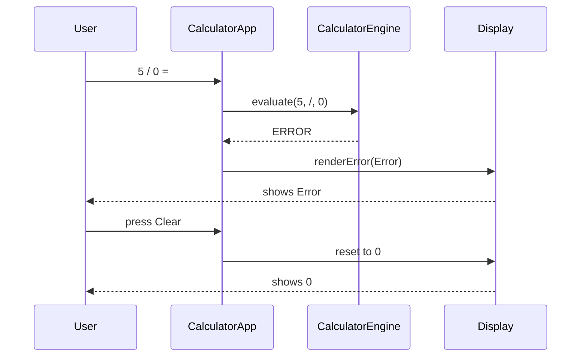
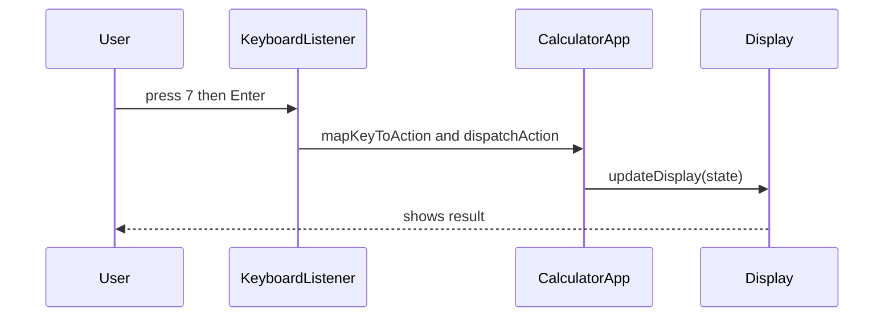
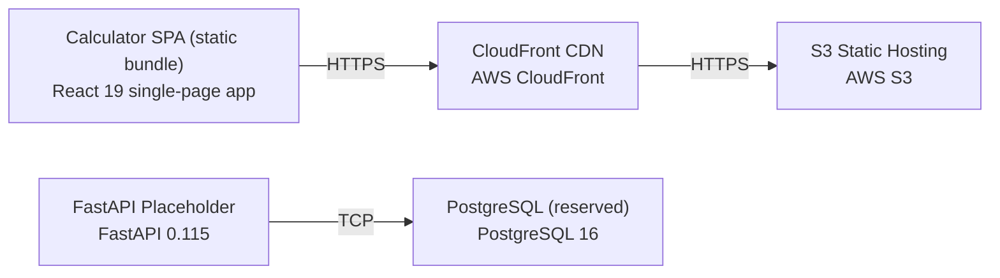

# Architecture

> Maintained by QuorQ AI SDLC. Text between `sdlc:auto` markers is regenerated; anything outside them is yours and is kept.

<!-- sdlc:auto:start narrative -->
## Overview

_No entries for this phase yet._
<!-- sdlc:auto:end narrative -->

<!-- sdlc:auto:start building-blocks -->
## Building Block View

| ID | Name | Technology | Responsibility | Depends on |
|---|---|---|---|---|
| spa | Calculator SPA | React 19 | Renders the responsive button grid and display, handles on-screen and physical keyboard input, holds all calculator state, runs the arithmetic engine, and manages decimal/sign/backspace/clear and error states entirely in the browser. | — |
| static_host | Static Hosting + CDN | AWS (S3 static hosting + CloudFront) | Serves the compiled single-page app bundle globally with low latency over HTTPS so the calculator loads once and runs with no further server round-trips. | spa |
| backend | Backend Placeholder API | FastAPI 0.115 | Provisioned FastAPI service with no current request handling; reserved as a future home for optional server endpoints (e.g. usage analytics or shared history) without re-platforming. Not on the critical path for this version. | — |
| db | Database (reserved) | PostgreSQL 16 | Provisioned PostgreSQL instance kept as the default persistence store for any future feature that must be remembered. No tables, writes or reads in this version since the calculator stores nothing. | — |

<!-- sdlc:auto:end building-blocks -->

<!-- sdlc:auto:start runtime -->
## Runtime View

### Evaluate an arithmetic operation

User enters a first operand, an operator and a second operand, then presses equals; the engine computes the result (add/subtract/multiply/divide/percent), applies the digit limit, and updates the display. Supports chaining by using the running result as the next first operand.

- **Components:** spa
- **Modules:** CalculatorApp, CalculatorEngine, Display, Keypad
- **Key functions:** inputDigit(d), inputOperator(op), inputDecimal(), applyPercent(), toggleSign(), evaluate(firstOperand, operator, secondOperand), formatForDisplay(value, maxDigits)

### Divide-by-zero and invalid-operation handling

When a division by zero or an otherwise undefined result is evaluated, the engine returns an error marker instead of a numeric value, the display enters an error state, and clear/reset returns the calculator to its initial zero state without reloading.

- **Components:** spa
- **Modules:** CalculatorApp, CalculatorEngine, Display
- **Key functions:** evaluate(firstOperand, operator, secondOperand), isError(result), clear(), renderError(message)

### Keyboard and on-screen input parity

Physical keyboard key presses (digits, + - * /, Enter for equals, Backspace, . and %) are mapped to the same handlers as the on-screen buttons so both input methods register once and update the display identically and immediately.

- **Components:** spa
- **Modules:** CalculatorApp, KeyboardListener, Keypad, Display
- **Key functions:** handleKeyDown(event), mapKeyToAction(key), dispatchAction(action), updateDisplay(state)

<!-- sdlc:auto:end runtime -->

<!-- sdlc:auto:start deployment-view -->
## Deployment View

| Name | Service | Runtime | Scaling | Environment |
|---|---|---|---|---|
| Calculator SPA (static bundle) | React 19 single-page app | Browser (compiled static JS/CSS/HTML) | CDN edge distribution; scales with CloudFront | dev |
| S3 Static Hosting | AWS S3 | AWS managed object storage | Managed, effectively unlimited | dev |
| CloudFront CDN | AWS CloudFront | AWS managed global edge network | Global edge caching, auto-scaled | dev |
| FastAPI Placeholder | FastAPI 0.115 | Python ASGI (uvicorn) | Single small instance; idle, no traffic in MVP | dev |
| PostgreSQL (reserved) | PostgreSQL 16 | AWS managed PostgreSQL | Single small instance; unused in MVP | dev |

| Source | Target | Protocol |
|---|---|---|
| CloudFront CDN | S3 Static Hosting | HTTPS |
| Calculator SPA (static bundle) | CloudFront CDN | HTTPS |
| FastAPI Placeholder | PostgreSQL (reserved) | TCP |

<!-- sdlc:auto:end deployment-view -->

<!-- sdlc:auto:start decisions -->
## Architecture Decisions

| Layer | Choice | ADR |
|---|---|---|
| Frontend | React 19 | [ADR-0001](adr/frontend.md) |
| Backend | FastAPI 0.115 | [ADR-0002](adr/backend.md) |
| Database | PostgreSQL 16 | [ADR-0003](adr/database.md) |
| Cloud | AWS | [ADR-0004](adr/cloud.md) |
<!-- sdlc:auto:end decisions -->

<!-- sdlc:auto:start links -->
## Related Documents

- [Data Model](data-model.md)
- [API Specification](api/openapi.yaml)
- [Architecture Decision Records](adr/README.md)
<!-- sdlc:auto:end links -->
