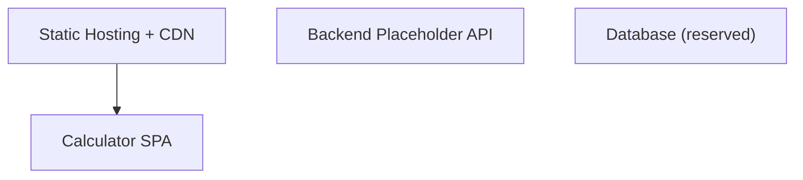
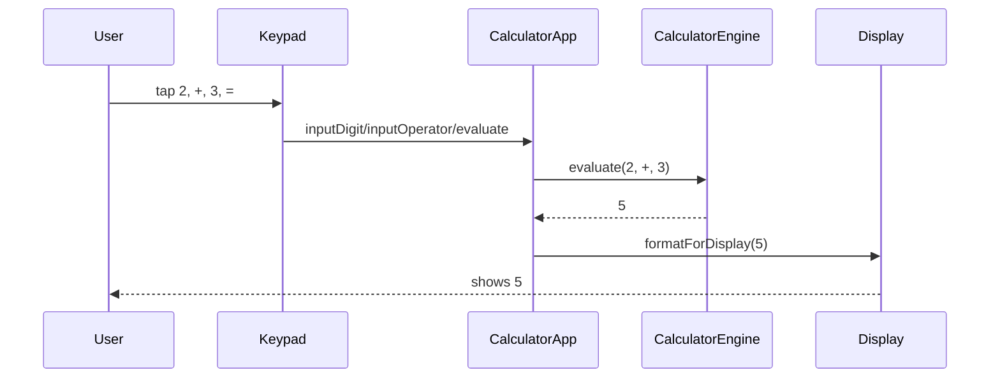
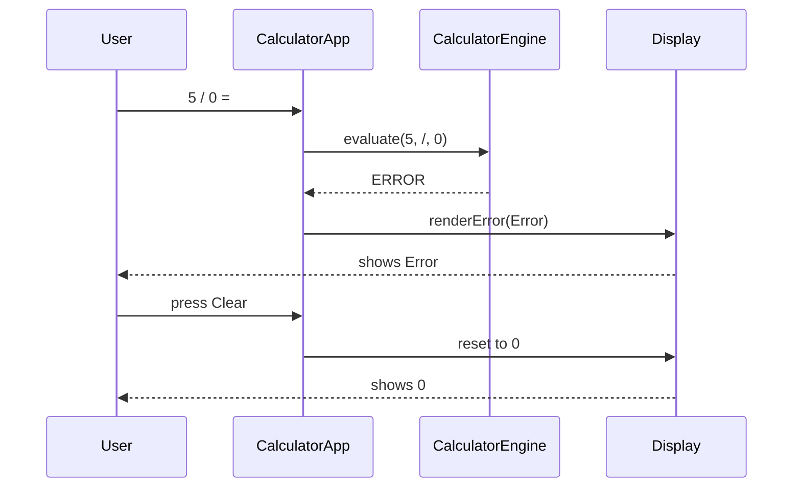
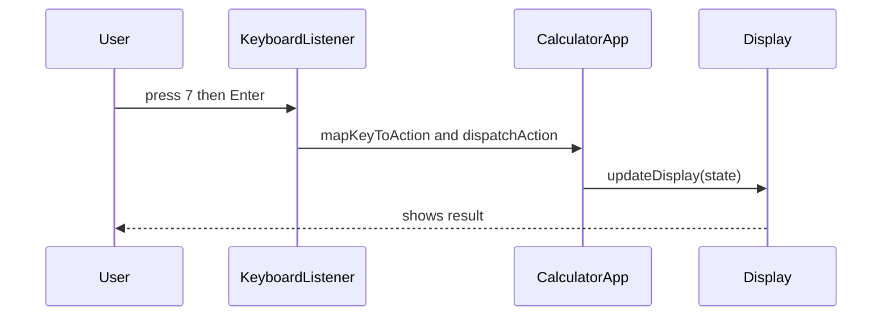
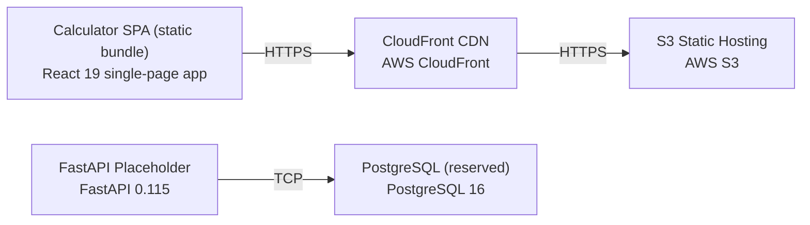

# Architecture

> Maintained by QuorQ AI SDLC. Text between `sdlc:auto` markers is regenerated; anything outside them is yours and is kept.

<!-- sdlc:auto:start narrative -->
## Overview

### ARCH-COMPONENTS · approved · source: architecture:components

Four components define the system: the Calculator SPA (all logic/UI), static hosting+CDN, and two forward-looking placeholders (backend API, database) with no active logic in this version.

- spa: Calculator SPA (React 19) renders the responsive button grid and display, handles on-screen and physical keyboard input, holds all calculator state, runs the arithmetic engine, and manages decimal/sign/backspace/clear and error states entirely in the browser.
- static_host: Static Hosting + CDN (AWS S3 static hosting + CloudFront) serves the compiled SPA bundle globally over HTTPS with low latency so the app loads once with no further server round-trips.
- backend: Backend Placeholder API (FastAPI 0.115) is provisioned with no current request handling; reserved for optional future server endpoints (e.g. usage analytics or shared history). Not on the critical path for this version.
- db: Database (reserved) (PostgreSQL 16) is provisioned as the default persistence store for any future feature needing memory; no tables, writes or reads occur in this version since the calculator stores nothing.

**Related:** US-001, US-002, US-003, US-004, US-005, US-006, US-007, US-008, US-009, US-010, US-011, US-012, US-013, US-014, US-016, US-019, US-020, US-021, US-022

### ARCH-CRITICAL-PATHS · approved · source: architecture:critical_paths

Three critical paths cover arithmetic evaluation (including chaining), divide-by-zero/invalid-operation handling, and keyboard/on-screen input parity.

1. Evaluate an arithmetic operation: user enters first operand, operator, second operand, presses equals; engine computes add/subtract/multiply/divide/percent, applies digit limit, updates display. Supports chaining by using the running result as the next first operand.
2. Divide-by-zero and invalid-operation handling: when division by zero or an undefined result is evaluated, the engine returns an error marker instead of a numeric value, the display enters an error state, and clear/reset returns the calculator to its initial zero state without reloading.
3. Keyboard and on-screen input parity: physical keyboard keys (digits, + - * /, Enter for equals, Backspace, . and %) map to the same handlers as on-screen buttons so both input methods register once and update the display identically and immediately.

**Related:** US-001, US-002, US-003, US-004, US-005, US-006, US-007, US-008, US-009, US-010, US-011, US-012, US-013, US-014

### ARCH-DEPLOYMENT-TOPOLOGY · approved · source: architecture:deployment_nodes

Deployment topology is a static SPA bundle served from AWS S3 behind CloudFront, plus a provisioned-but-idle FastAPI/PostgreSQL pair for future use.

Nodes: (1) Calculator SPA static bundle running as compiled static JS/CSS/HTML in the browser; (2) S3 Static Hosting on AWS managed object storage; (3) CloudFront CDN on AWS managed global edge network fronting S3 for low-latency global delivery; (4) FastAPI Placeholder running on Python ASGI/uvicorn, provisioned but handling no requests; (5) PostgreSQL (reserved) on AWS managed PostgreSQL 16, provisioned with no schema or data in this version.

- ⚠ Backend and database nodes are provisioned infrastructure with no defined schema, API spec, or usage yet -- confirm whether this idle cost/footprint is intended to persist across further versions or should be deferred until a feature needs it.

### ARCH-TECH-DECISIONS · approved · source: architecture:technology_decisions

Four technology decisions were made: React 19 frontend, FastAPI 0.115 backend placeholder, PostgreSQL 16 reserved database, and AWS (S3+CloudFront) cloud hosting.

- Frontend: React 19 chosen over Vue, Svelte, Vanilla JS -- renders the responsive button grid, drives instant display updates for on-screen taps and keyboard input, and ships as a single-page app with no server round-trips, matching NFR-002 and NFR-004.
- Backend: FastAPI 0.115 chosen over Flask, Express, No backend -- no server-side logic exists in this client-only calculator; FastAPI is provisioned as a lightweight, ready place to add an endpoint later (e.g. usage analytics or shared history) without re-platforming.
- Database: PostgreSQL 16 chosen over SQLite, DynamoDB, No database -- nothing is stored or persisted between sessions, so it defines no schema today but is named as the default store should a future feature (saved calculations, usage counts) need persistence.
- Cloud: AWS chosen over Vercel, Netlify, Cloudflare Pages -- S3 static hosting plus CloudFront CDN keeps load times low for all desktop and mobile visitors (NFR-003) and keeps every layer on one provider for billing and operations.

- ⚠ NFR-002, NFR-003 and NFR-004 are referenced by these decisions but are not present in the known requirement keys list provided for this phase -- confirm these NFR ids are correctly tracked in the requirements set.

### ARCH-REVIEW-V1 · approved · source: architecture:summary

This is a review revision (version 1, approved) of the architecture against unchanged requirements; every prior decision -- component ids, critical paths, empty data model, empty API spec, deployment topology, and technology decisions -- was carried forward unchanged with no new capabilities, services, or packages introduced.

The architecture documents simple calculator-2 as a client-side-only React 19 SPA performing addition, subtraction, multiplication, division and percent, with chained operations, decimal entry, sign toggle, backspace, clear/reset, digit limiting, and keyboard/on-screen input parity, plus graceful divide-by-zero and invalid-operation error handling -- all in-browser with nothing stored or transmitted. FastAPI 0.115 and PostgreSQL 16 are named as forward-looking defaults, provisioned but hosting no logic or schema in this version. The app is served as static assets from AWS S3 fronted by CloudFront for free, login-free, fast global access on desktop and mobile.

**Related:** US-001, US-002, US-003, US-004, US-005, US-006, US-007, US-008, US-009, US-010, US-011, US-012, US-013, US-014, US-016, US-019, US-020, US-021, US-022

- ⚠ Data model is explicitly empty and API spec is explicitly empty in this version -- this is stated as intentional (no persistence, no server logic) rather than a documentation gap, but should be re-confirmed if a future version activates the backend/database.
<!-- sdlc:auto:end narrative -->

<!-- sdlc:auto:start building-blocks -->
## Building Block View

| ID | Name | Technology | Responsibility | Depends on |
|---|---|---|---|---|
| spa | Calculator SPA | React 19 | Renders the responsive button grid and display, handles on-screen and physical keyboard input, holds all calculator state, runs the arithmetic engine, and manages decimal/sign/backspace/clear and error states entirely in the browser. | — |
| static_host | Static Hosting + CDN | AWS (S3 static hosting + CloudFront) | Serves the compiled single-page app bundle globally with low latency over HTTPS so the calculator loads once and runs with no further server round-trips. | spa |
| backend | Backend Placeholder API | FastAPI 0.115 | Provisioned FastAPI service with no current request handling; reserved as a future home for optional server endpoints (e.g. usage analytics or shared history) without re-platforming. Not on the critical path for this version. | — |
| db | Database (reserved) | PostgreSQL 16 | Provisioned PostgreSQL instance kept as the default persistence store for any future feature that must be remembered. No tables, writes or reads in this version since the calculator stores nothing. | — |

<!-- sdlc:auto:end building-blocks -->

<!-- sdlc:auto:start runtime -->
## Runtime View

### Evaluate an arithmetic operation

User enters a first operand, an operator and a second operand, then presses equals; the engine computes the result (add/subtract/multiply/divide/percent), applies the digit limit, and updates the display. Supports chaining by using the running result as the next first operand.

- **Components:** spa
- **Modules:** CalculatorApp, CalculatorEngine, Display, Keypad
- **Key functions:** inputDigit(d), inputOperator(op), inputDecimal(), applyPercent(), toggleSign(), evaluate(firstOperand, operator, secondOperand), formatForDisplay(value, maxDigits)

### Divide-by-zero and invalid-operation handling

When a division by zero or an otherwise undefined result is evaluated, the engine returns an error marker instead of a numeric value, the display enters an error state, and clear/reset returns the calculator to its initial zero state without reloading.

- **Components:** spa
- **Modules:** CalculatorApp, CalculatorEngine, Display
- **Key functions:** evaluate(firstOperand, operator, secondOperand), isError(result), clear(), renderError(message)

### Keyboard and on-screen input parity

Physical keyboard key presses (digits, + - * /, Enter for equals, Backspace, . and %) are mapped to the same handlers as the on-screen buttons so both input methods register once and update the display identically and immediately.

- **Components:** spa
- **Modules:** CalculatorApp, KeyboardListener, Keypad, Display
- **Key functions:** handleKeyDown(event), mapKeyToAction(key), dispatchAction(action), updateDisplay(state)

<!-- sdlc:auto:end runtime -->

<!-- sdlc:auto:start deployment-view -->
## Deployment View

| Name | Service | Runtime | Scaling | Environment |
|---|---|---|---|---|
| Calculator SPA (static bundle) | React 19 single-page app | Browser (compiled static JS/CSS/HTML) | CDN edge distribution; scales with CloudFront | dev |
| S3 Static Hosting | AWS S3 | AWS managed object storage | Managed, effectively unlimited | dev |
| CloudFront CDN | AWS CloudFront | AWS managed global edge network | Global edge caching, auto-scaled | dev |
| FastAPI Placeholder | FastAPI 0.115 | Python ASGI (uvicorn) | Single small instance; idle, no traffic in MVP | dev |
| PostgreSQL (reserved) | PostgreSQL 16 | AWS managed PostgreSQL | Single small instance; unused in MVP | dev |

| Source | Target | Protocol |
|---|---|---|
| Calculator SPA (static bundle) | CloudFront CDN | HTTPS |
| CloudFront CDN | S3 Static Hosting | HTTPS |
| FastAPI Placeholder | PostgreSQL (reserved) | TCP |

<!-- sdlc:auto:end deployment-view -->

<!-- sdlc:auto:start decisions -->
## Architecture Decisions

| Layer | Choice | ADR |
|---|---|---|
| Frontend | React 19 | [ADR-0001](adr/frontend.md) |
| Backend | FastAPI 0.115 | [ADR-0002](adr/backend.md) |
| Database | PostgreSQL 16 | [ADR-0003](adr/database.md) |
| Cloud | AWS | [ADR-0004](adr/cloud.md) |
<!-- sdlc:auto:end decisions -->

<!-- sdlc:auto:start links -->
## Related Documents

- [Data Model](data-model.md)
- [API Specification](api/openapi.yaml)
- [Architecture Decision Records](adr/README.md)
<!-- sdlc:auto:end links -->
