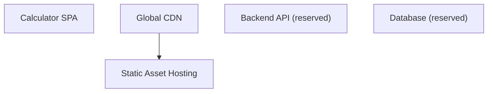
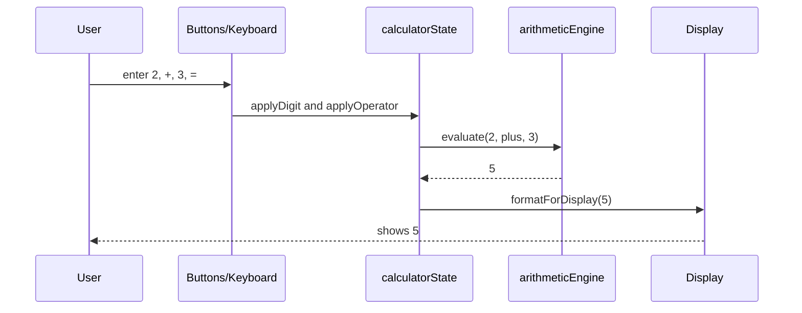
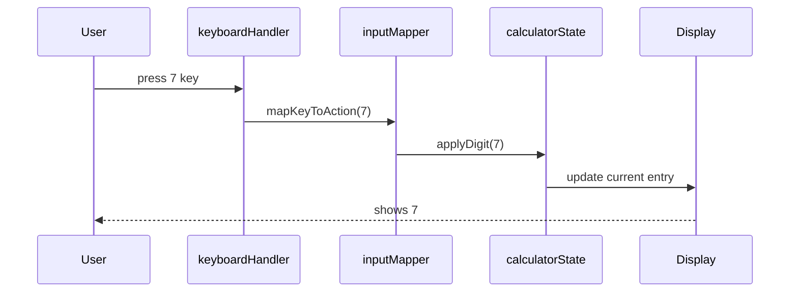
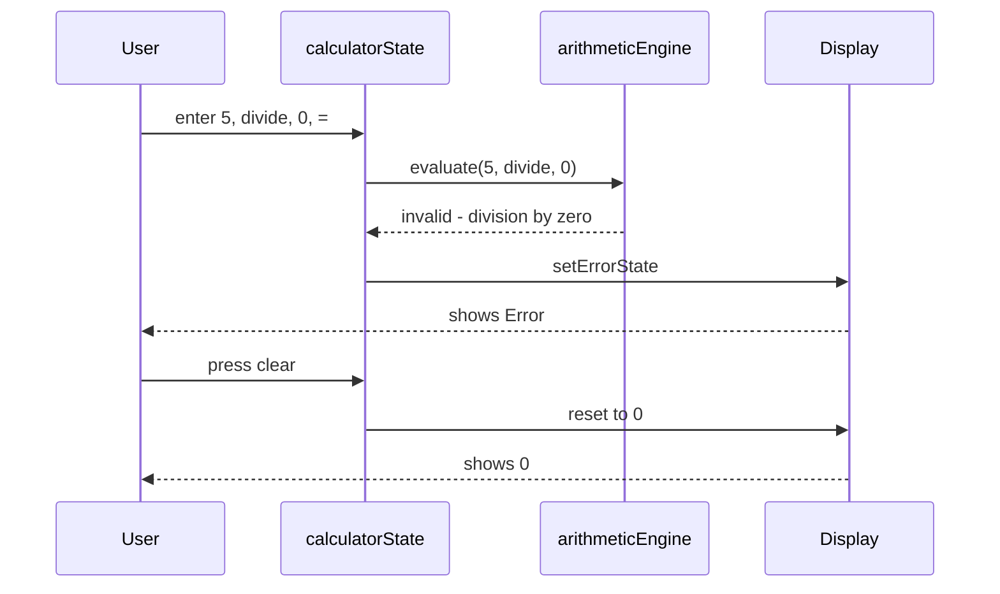
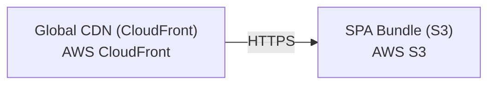

# Architecture

> Maintained by QuorQ AI SDLC. Text between `sdlc:auto` markers is regenerated; anything outside them is yours and is kept.

<!-- sdlc:auto:start narrative -->
## Overview

### ARCH-001 · approved · source: architecture:summary

Simple Calculator-2 is an approved (v2) client-side-only single-page web application performing basic arithmetic, built entirely in React 19 and requiring no accounts, payments, or data persistence.

Approved architecture, version 2. The app runs entirely in the visitor's browser (React 19 SPA) covering addition, subtraction, multiplication, division, percent, decimal entry, sign toggle, backspace, divide-by-zero/invalid-operation error handling, on-screen and physical keyboard input, and a responsive desktop/mobile layout. Delivery is via AWS S3 static hosting plus CloudFront CDN worldwide. FastAPI 0.115 and PostgreSQL 16 are named as approved backend/database defaults but perform no runtime work today; they are reserved only for a possible future server-side feature (e.g. usage analytics).

**Related:** US-001, US-002, US-003, US-004, US-005, US-006, US-007, US-008, US-009, US-010, US-011, US-012, US-013, US-014, US-016, US-019, US-020, US-021, US-022

### ARCH-002 · approved · source: architecture:components:calculator_spa

The Calculator SPA (React 19) is the core and only functionally active component, rendering the UI and running all logic in-browser.

Renders the responsive button grid and display, captures both on-screen and physical keyboard input, runs all arithmetic and error handling entirely client-side, and holds calculator state in memory only -- nothing is persisted across sessions.

**Related:** US-001, US-002, US-003, US-004, US-005, US-006, US-007, US-008, US-016, US-020, US-021, US-022

### ARCH-003 · approved · source: architecture:components:static_hosting

AWS S3 stores the built SPA bundle (HTML/JS/CSS) as static objects for delivery.

Static Asset Hosting component: holds the compiled SPA bundle as static objects in S3; no server-side processing occurs here. Pairs with the CloudFront CDN (ARCH-004) for global delivery.

### ARCH-004 · approved · source: architecture:components:cdn

AWS CloudFront serves the SPA over HTTPS from edge locations worldwide for low-latency loads on desktop and mobile.

Global CDN component: delivers the S3-hosted bundle over HTTPS from edge locations. The app loads once and needs no further round-trips after initial load, supporting low-latency access on desktop and mobile per NFR-003.

- ⚠ Referenced NFR-003 is not present in the supplied list of known requirement keys -- confirm this requirement id exists and is correctly tracked.

### ARCH-005 · approved · source: architecture:components:backend_api

FastAPI 0.115 is the approved backend default but is not performing any server-side logic in the current build.

Backend API (reserved) component: no server-side logic runs today since the calculator is entirely client-side. It is reserved as a ready place to add a future endpoint (e.g. usage analytics or shared history) without re-platforming.

- ⚠ No current requirement drives active use of this component; it exists purely as a reserved future capability.

### ARCH-006 · approved · source: architecture:components:database

PostgreSQL 16 is the approved database default but writes no data today, since the calculator persists nothing.

Database (reserved) component: approved default store, currently unused because the calculator does not persist any data. Reserved for any future feature that must remember state (e.g. saved calculations, usage counts).

- ⚠ No current requirement drives active use of this component; it exists purely as a reserved future capability.

### ARCH-007 · approved · source: architecture:critical_paths:Arithmetic evaluation and chaining

Describes the end-to-end flow for entering operands/operators and evaluating results, including chained operations.

User enters a first operand, an operator, a second operand, and equals; the engine evaluates the operation and displays the result. Chaining reuses the running result as the next first operand, allowing successive operations without re-entering it.

**Related:** US-001, US-002, US-003, US-004, US-016, US-020

### ARCH-008 · approved · source: architecture:critical_paths:Input capture (buttons and keyboard)

On-screen taps/clicks and physical key presses are unified into the same input actions with immediate display updates.

On-screen button taps/clicks and physical keyboard key presses map to the same underlying input actions; each registers exactly once and updates the display immediately, ensuring consistent behavior regardless of input method.

**Related:** US-006, US-007, US-008, US-021, US-022

- ⚠ Referenced NFR-002 is not present in the supplied list of known requirement keys -- confirm this requirement id exists and is correctly tracked.

### ARCH-009 · approved · source: architecture:critical_paths:Error handling and recovery

Defines how divide-by-zero and invalid operations are surfaced and how the calculator recovers back to a clean state.

Divide-by-zero and other invalid operations put the calculator into an error state that shows a clear indication rather than a misleading numeric value. Pressing clear/reset exits the error state back to the initial zero state without requiring a page reload.

**Related:** US-005, US-010, US-011

- ⚠ Referenced NFR-006 is not present in the supplied list of known requirement keys -- confirm this requirement id exists and is correctly tracked.

### ARCH-010 · approved · source: architecture:deployment_nodes

Two deployment nodes deliver the SPA: an S3 static object store and a CloudFront edge CDN layer over HTTPS.

SPA Bundle (S3): AWS S3 static object storage hosting the built bundle. Global CDN (CloudFront): AWS CloudFront edge CDN distributing the bundle over HTTPS worldwide. Together these form the entire runtime deployment topology -- there is no application server or database node active in production today.

### ARCH-011 · approved · source: architecture:technology_decisions:Frontend

React 19 was selected as the frontend framework, over Vue and Svelte alternatives, to host the entire product's UI and logic.

React 19 renders the responsive button grid and display, handles on-screen and keyboard input, and runs all arithmetic and error handling in the browser as a single-page app that loads once. Alternatives considered: Vue, Svelte.

**Related:** US-001, US-002, US-003, US-004, US-005, US-006, US-007, US-008, US-009, US-010, US-011, US-012, US-013, US-014, US-016, US-019, US-020, US-021, US-022

- ⚠ Rationale for choosing React over Vue/Svelte beyond 'entire product lives here' is not detailed in the input.

### ARCH-012 · approved · source: architecture:technology_decisions:Backend

FastAPI 0.115 was named the approved backend default (over Express, Django) despite no current server-side need.

No server-side logic is required today since the calculator is client-side only; FastAPI 0.115 is kept as the approved default, providing a ready place to add a future endpoint such as usage analytics without re-platforming. Alternatives considered: Express, Django.

### ARCH-013 · approved · source: architecture:technology_decisions:Database

PostgreSQL 16 was named the approved database default (over MySQL, SQLite) despite no current persistence need.

Nothing is persisted between sessions so no database is used today; PostgreSQL 16 is named as the approved default so any later need to remember data (saved calculations, usage counts) has a dependable store ready. Alternatives considered: MySQL, SQLite.

### ARCH-014 · approved · source: architecture:technology_decisions:Cloud

AWS (S3 + CloudFront) was selected as the cloud provider, over Azure and Cloudflare, to deliver the free public SPA worldwide on one provider.

A free, public SPA needs reliable worldwide reach; AWS static hosting (S3) plus a global CDN (CloudFront) keeps load times low for all visitors and keeps every layer on one provider for billing and operations, supporting NFR-003. Alternatives considered: Azure, Cloudflare.

- ⚠ Referenced NFR-003 is not present in the supplied list of known requirement keys -- confirm this requirement id exists and is correctly tracked.
<!-- sdlc:auto:end narrative -->

<!-- sdlc:auto:start building-blocks -->
## Building Block View

| ID | Name | Technology | Responsibility | Depends on |
|---|---|---|---|---|
| calculator_spa | Calculator SPA | React 19 | Renders the responsive button grid and display, captures on-screen and keyboard input, runs all arithmetic and error handling entirely in the browser, and holds calculator state in memory only (nothing persisted). | — |
| static_hosting | Static Asset Hosting | AWS S3 | Stores the built SPA bundle (HTML, JS, CSS) as static objects for delivery. | — |
| cdn | Global CDN | AWS CloudFront | Serves the SPA over HTTPS from edge locations worldwide for low-latency loads on desktop and mobile; the app loads once and needs no further round-trips. | static_hosting |
| backend_api | Backend API (reserved) | FastAPI 0.115 | Approved backend default with no server-side logic today; reserved as a ready place to add a future endpoint (e.g. usage analytics or shared history) without re-platforming. | — |
| database | Database (reserved) | PostgreSQL 16 | Approved database default; writes no data today because the calculator persists nothing, reserved for any future feature that must be remembered. | — |

<!-- sdlc:auto:end building-blocks -->

<!-- sdlc:auto:start runtime -->
## Runtime View

### Arithmetic evaluation and chaining

User enters a first operand, an operator, a second operand and equals; the engine evaluates the operation and displays the result. Chaining reuses the running result as the next first operand (US-001..US-004, US-016, US-020).

- **Components:** calculator_spa
- **Modules:** calculatorState, arithmeticEngine, displayFormatter
- **Key functions:** applyDigit(state, digit), applyOperator(state, op), applyPercent(state), evaluate(firstOperand, op, secondOperand), formatForDisplay(value, maxDigits)

### Input capture (buttons and keyboard)

On-screen taps/clicks and physical key presses map to the same input actions, each registering once and updating the display immediately (US-006, US-007, US-008, US-021, US-022, NFR-002).

- **Components:** calculator_spa
- **Modules:** buttonGrid, keyboardHandler, inputMapper, calculatorState
- **Key functions:** onButtonPress(key), onKeyDown(event), mapKeyToAction(key), applyDecimal(state), toggleSign(state), backspace(state)

### Error handling and recovery

Divide-by-zero and other invalid operations put the calculator into an error state showing a clear indication rather than a misleading value; clear/reset exits the error back to the initial zero state with no reload (US-010, US-011, US-005, NFR-006).

- **Components:** calculator_spa
- **Modules:** arithmeticEngine, calculatorState, displayFormatter
- **Key functions:** evaluate(firstOperand, op, secondOperand), isInvalidResult(value), setErrorState(state), clear(state)

<!-- sdlc:auto:end runtime -->

<!-- sdlc:auto:start deployment-view -->
## Deployment View

| Name | Service | Runtime | Scaling | Environment |
|---|---|---|---|---|
| SPA Bundle (S3) | AWS S3 | Static object storage | Managed by AWS, effectively unlimited for static assets | dev |
| Global CDN (CloudFront) | AWS CloudFront | Edge CDN over HTTPS | Auto-scaled global edge network | dev |

| Source | Target | Protocol |
|---|---|---|
| Global CDN (CloudFront) | SPA Bundle (S3) | HTTPS |

<!-- sdlc:auto:end deployment-view -->

<!-- sdlc:auto:start decisions -->
## Architecture Decisions

| Layer | Choice | ADR |
|---|---|---|
| Frontend | React 19 | [ADR-0001](adr/frontend.md) |
| Backend | FastAPI 0.115 | [ADR-0002](adr/backend.md) |
| Database | PostgreSQL 16 | [ADR-0003](adr/database.md) |
| Cloud | AWS | [ADR-0004](adr/cloud.md) |
<!-- sdlc:auto:end decisions -->

<!-- sdlc:auto:start links -->
## Related Documents

- [Data Model](data-model.md)
- [API Specification](api/openapi.yaml)
- [Architecture Decision Records](adr/README.md)
<!-- sdlc:auto:end links -->
