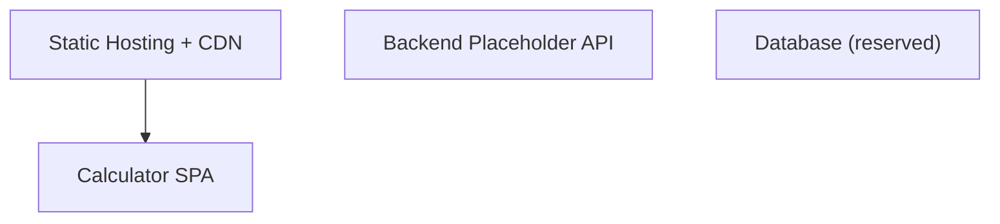
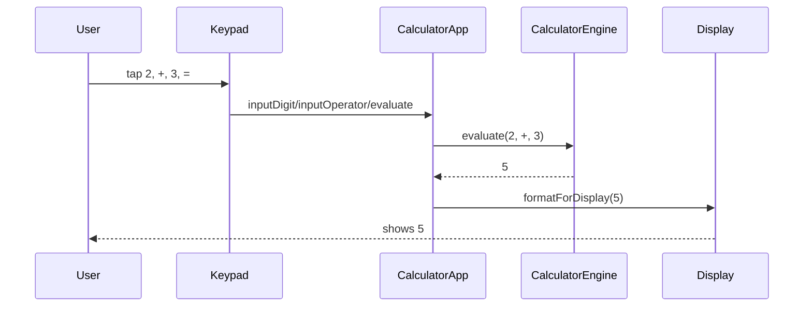
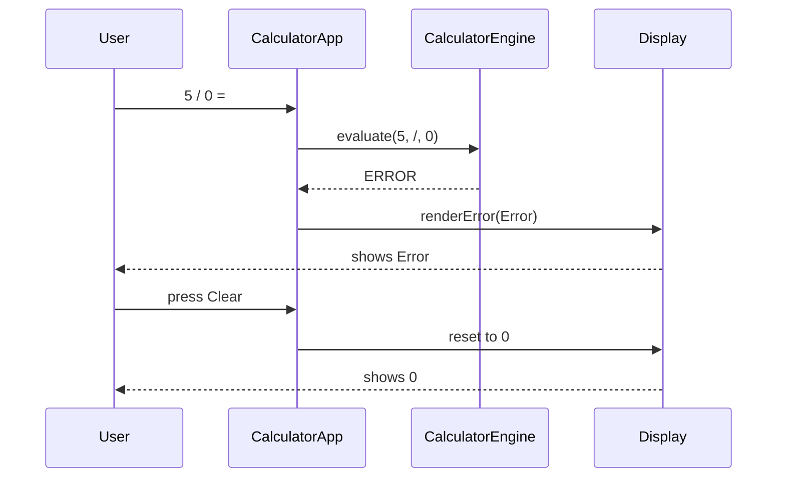
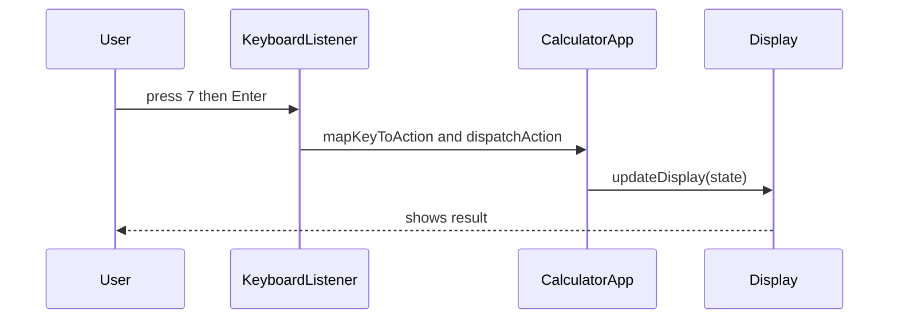
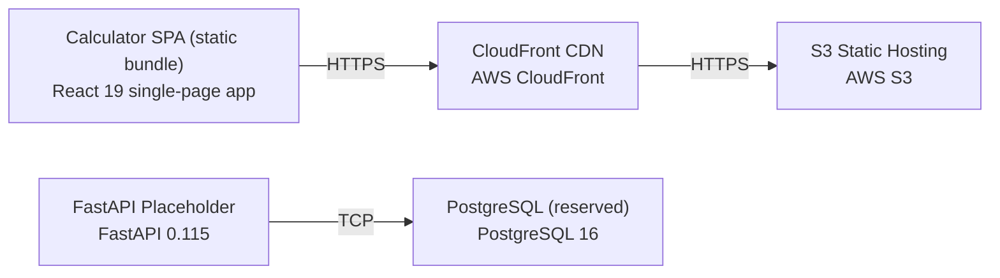

# Architecture

> Maintained by QuorQ AI SDLC. Text between `sdlc:auto` markers is regenerated; anything outside them is yours and is kept.

<!-- sdlc:auto:start narrative -->
## Overview

### ARCH-001 · approved · source: architecture:summary

Simple calculator-2 is approved (version 1) as a client-side-only single-page web app performing standard arithmetic with no persistence or server-side logic.

The entire product lives in the browser as a React 19 SPA: all calculation state and arithmetic run client-side, nothing is stored or transmitted, and nothing persists between sessions. FastAPI 0.115 and PostgreSQL 16 are named as forward-looking defaults in the approved stack but carry no server-side logic or schema in this version. The app is hosted as static assets on AWS (S3 static hosting fronted by CloudFront) for fast, reliable, login-free, free public access on desktop and mobile browsers. Supported functionality: addition, subtraction, multiplication, division, percent, decimal entry, sign toggle, backspace, clear/reset, chained operations, and graceful divide-by-zero/invalid-operation error handling.

- ⚠ Architecture input does not state which specific requirement IDs (US-001..US-022) each capability (e.g. addition, percent, chaining) maps to -- requirement-to-architecture traceability is not explicit in this input.

### ARCH-002 · approved · source: architecture:components.spa

Calculator SPA (React 19) is the sole functional component: it renders the UI and runs all calculator logic client-side.

Renders the responsive button grid and display, handles on-screen and physical keyboard input, holds all calculator state, runs the arithmetic engine, and manages decimal/sign/backspace/clear and error states entirely in the browser. No backend calls are made.

### ARCH-003 · approved · source: architecture:components.static_host

Static Hosting + CDN (AWS S3 + CloudFront) serves the compiled SPA bundle globally over HTTPS.

Serves the compiled single-page app bundle globally with low latency over HTTPS so the calculator loads once and runs with no further server round-trips after initial load.

**Related:** ARCH-002

### ARCH-004 · approved · source: architecture:components.backend

Backend Placeholder API (FastAPI 0.115) is provisioned but inactive in this version, reserved for future optional endpoints.

Provisioned FastAPI service with no current request handling; reserved as a future home for optional server endpoints (e.g. usage analytics or shared history) without re-platforming. Not on the critical path for this version.

- ⚠ No request handlers, routes, or contracts are defined yet since the component is a placeholder -- expected and noted, not a defect.

### ARCH-005 · approved · source: architecture:components.db

Database (reserved) (PostgreSQL 16) is provisioned but unused -- no schema, tables, writes, or reads in this version.

Provisioned PostgreSQL instance kept as the default persistence store for any future feature that must be remembered. No tables, writes or reads in this version since the calculator stores nothing.

**Related:** ARCH-004

- ⚠ No schema design exists yet; will need definition if/when a persistence feature is approved.

### ARCH-006 · approved · source: architecture:critical_paths.evaluate_operation

Critical path for evaluating an arithmetic operation: operand-operator-operand-equals flow with chaining support.

User enters a first operand, an operator and a second operand, then presses equals; the engine computes the result (add/subtract/multiply/divide/percent), applies the digit limit, and updates the display. Supports chaining by using the running result as the next first operand.

**Related:** ARCH-002

- ⚠ Specific requirement IDs behind each arithmetic operation (add/subtract/multiply/divide/percent) are not stated in this input.

### ARCH-007 · approved · source: architecture:critical_paths.divide_by_zero

Critical path for divide-by-zero and invalid-operation handling, including recovery via clear/reset.

When a division by zero or an otherwise undefined result is evaluated, the engine returns an error marker instead of a numeric value, the display enters an error state, and clear/reset returns the calculator to its initial zero state without reloading.

**Related:** ARCH-002, ARCH-006

### ARCH-008 · approved · source: architecture:critical_paths.keyboard_parity

Critical path ensuring keyboard and on-screen input parity so both input methods behave identically.

Physical keyboard key presses (digits, + - * /, Enter for equals, Backspace, . and %) are mapped to the same handlers as the on-screen buttons so both input methods register once and update the display identically and immediately.

**Related:** ARCH-002

### ARCH-009 · approved · source: architecture:deployment_nodes

Deployment topology: a static browser bundle served from S3 via CloudFront, plus reserved (inactive) FastAPI/PostgreSQL nodes.

Five deployment nodes: (1) Calculator SPA static bundle -- React 19 single-page app compiled to static JS/CSS/HTML, runs in the browser; (2) S3 Static Hosting -- AWS S3 managed object storage holding the bundle; (3) CloudFront CDN -- AWS managed global edge network distributing the bundle; (4) FastAPI Placeholder -- Python ASGI (uvicorn) service, provisioned but idle; (5) PostgreSQL (reserved) -- AWS managed PostgreSQL 16 instance, provisioned but idle.

**Related:** ARCH-002, ARCH-003, ARCH-004, ARCH-005

### ARCH-010 · approved · source: architecture:technology_decisions.frontend

Frontend technology decision: React 19, chosen over Vue, Svelte, and Vanilla JS.

The entire product lives in the browser. React 19 renders the responsive button grid and drives instant display updates for both on-screen taps and keyboard input, and ships as a single-page app that loads once with no server round-trips, matching NFR-002 and NFR-004.

- ⚠ NFR-002 and NFR-004 are referenced by this decision but are not present in the known requirement key list provided for this phase -- confirm these NFR IDs exist and are tracked.

### ARCH-011 · approved · source: architecture:technology_decisions.backend

Backend technology decision: FastAPI 0.115, chosen over Flask, Express, and no backend.

There is no server-side logic in this client-only calculator, so FastAPI 0.115 is provisioned only as a lightweight, ready place to add an endpoint later (e.g. usage analytics or shared history) without re-platforming.

**Related:** ARCH-004

### ARCH-012 · approved · source: architecture:technology_decisions.database

Database technology decision: PostgreSQL 16, chosen over SQLite, DynamoDB, and no database.

Nothing is stored or persisted between sessions, so PostgreSQL 16 defines no schema today; it is named as the default dependable store should a future feature (saved calculations, usage counts) need persistence.

**Related:** ARCH-005

### ARCH-013 · approved · source: architecture:technology_decisions.cloud

Cloud technology decision: AWS, chosen over Vercel, Netlify, and Cloudflare Pages.

A free, public SPA must be reliably reachable worldwide; AWS S3 static hosting plus a CloudFront CDN keeps load times low for all desktop and mobile visitors (NFR-003) and keeps every layer on one provider for billing and operations.

**Related:** ARCH-003

- ⚠ NFR-003 is referenced by this decision but is not present in the known requirement key list provided for this phase -- confirm this NFR ID exists and is tracked.
<!-- sdlc:auto:end narrative -->

<!-- sdlc:auto:start building-blocks -->
## Building Block View

| ID | Name | Technology | Responsibility | Depends on |
|---|---|---|---|---|
| spa | Calculator SPA | React 19 | Renders the responsive button grid and display, handles on-screen and physical keyboard input, holds all calculator state, runs the arithmetic engine, and manages decimal/sign/backspace/clear and error states entirely in the browser. | — |
| static_host | Static Hosting + CDN | AWS (S3 static hosting + CloudFront) | Serves the compiled single-page app bundle globally with low latency over HTTPS so the calculator loads once and runs with no further server round-trips. | spa |
| backend | Backend Placeholder API | FastAPI 0.115 | Provisioned FastAPI service with no current request handling; reserved as a future home for optional server endpoints (e.g. usage analytics or shared history) without re-platforming. Not on the critical path for this version. | — |
| db | Database (reserved) | PostgreSQL 16 | Provisioned PostgreSQL instance kept as the default persistence store for any future feature that must be remembered. No tables, writes or reads in this version since the calculator stores nothing. | — |

<!-- sdlc:auto:end building-blocks -->

<!-- sdlc:auto:start runtime -->
## Runtime View

### Evaluate an arithmetic operation

User enters a first operand, an operator and a second operand, then presses equals; the engine computes the result (add/subtract/multiply/divide/percent), applies the digit limit, and updates the display. Supports chaining by using the running result as the next first operand.

- **Components:** spa
- **Modules:** CalculatorApp, CalculatorEngine, Display, Keypad
- **Key functions:** inputDigit(d), inputOperator(op), inputDecimal(), applyPercent(), toggleSign(), evaluate(firstOperand, operator, secondOperand), formatForDisplay(value, maxDigits)

### Divide-by-zero and invalid-operation handling

When a division by zero or an otherwise undefined result is evaluated, the engine returns an error marker instead of a numeric value, the display enters an error state, and clear/reset returns the calculator to its initial zero state without reloading.

- **Components:** spa
- **Modules:** CalculatorApp, CalculatorEngine, Display
- **Key functions:** evaluate(firstOperand, operator, secondOperand), isError(result), clear(), renderError(message)

### Keyboard and on-screen input parity

Physical keyboard key presses (digits, + - * /, Enter for equals, Backspace, . and %) are mapped to the same handlers as the on-screen buttons so both input methods register once and update the display identically and immediately.

- **Components:** spa
- **Modules:** CalculatorApp, KeyboardListener, Keypad, Display
- **Key functions:** handleKeyDown(event), mapKeyToAction(key), dispatchAction(action), updateDisplay(state)

<!-- sdlc:auto:end runtime -->

<!-- sdlc:auto:start deployment-view -->
## Deployment View

| Name | Service | Runtime | Scaling | Environment |
|---|---|---|---|---|
| Calculator SPA (static bundle) | React 19 single-page app | Browser (compiled static JS/CSS/HTML) | CDN edge distribution; scales with CloudFront | dev |
| S3 Static Hosting | AWS S3 | AWS managed object storage | Managed, effectively unlimited | dev |
| CloudFront CDN | AWS CloudFront | AWS managed global edge network | Global edge caching, auto-scaled | dev |
| FastAPI Placeholder | FastAPI 0.115 | Python ASGI (uvicorn) | Single small instance; idle, no traffic in MVP | dev |
| PostgreSQL (reserved) | PostgreSQL 16 | AWS managed PostgreSQL | Single small instance; unused in MVP | dev |

| Source | Target | Protocol |
|---|---|---|
| CloudFront CDN | S3 Static Hosting | HTTPS |
| Calculator SPA (static bundle) | CloudFront CDN | HTTPS |
| FastAPI Placeholder | PostgreSQL (reserved) | TCP |

<!-- sdlc:auto:end deployment-view -->

<!-- sdlc:auto:start decisions -->
## Architecture Decisions

| Layer | Choice | ADR |
|---|---|---|
| Frontend | React 19 | [ADR-0001](adr/frontend.md) |
| Backend | FastAPI 0.115 | [ADR-0002](adr/backend.md) |
| Database | PostgreSQL 16 | [ADR-0003](adr/database.md) |
| Cloud | AWS | [ADR-0004](adr/cloud.md) |
<!-- sdlc:auto:end decisions -->

<!-- sdlc:auto:start links -->
## Related Documents

- [Data Model](data-model.md)
- [API Specification](api/openapi.yaml)
- [Architecture Decision Records](adr/README.md)
<!-- sdlc:auto:end links -->
