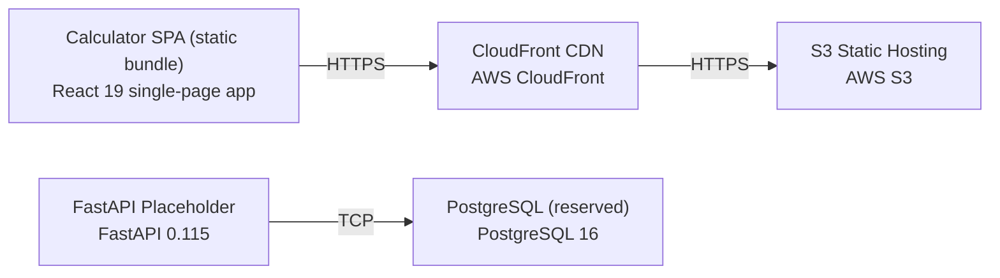

# Deployment Guide

> Maintained by QuorQ AI SDLC. Text between `sdlc:auto` markers is regenerated; anything outside them is yours and is kept.

<!-- sdlc:auto:start how-it-deploys -->
Pushes to `main` run `.github/workflows/deploy.yml`, which builds the API image (if there is a backend) and deploys the SPA to AWS Amplify. Commits touching only `docs/sdlc/**` don't deploy. Deployments can also be started from the platform's Deployment tab.
<!-- sdlc:auto:end how-it-deploys -->

<!-- sdlc:auto:start environments -->
| Name | Service | Runtime | Scaling | Environment |
|---|---|---|---|---|
| Calculator SPA (static bundle) | React 19 single-page app | Browser (compiled static JS/CSS/HTML) | CDN edge distribution; scales with CloudFront | dev |
| S3 Static Hosting | AWS S3 | AWS managed object storage | Managed, effectively unlimited | dev |
| CloudFront CDN | AWS CloudFront | AWS managed global edge network | Global edge caching, auto-scaled | dev |
| FastAPI Placeholder | FastAPI 0.115 | Python ASGI (uvicorn) | Single small instance; idle, no traffic in MVP | dev |
| PostgreSQL (reserved) | PostgreSQL 16 | AWS managed PostgreSQL | Single small instance; unused in MVP | dev |
<!-- sdlc:auto:end environments -->

<!-- sdlc:auto:start live -->
_Not deployed yet._
<!-- sdlc:auto:end live -->

<!-- sdlc:auto:start topology -->

<!-- sdlc:auto:end topology -->
